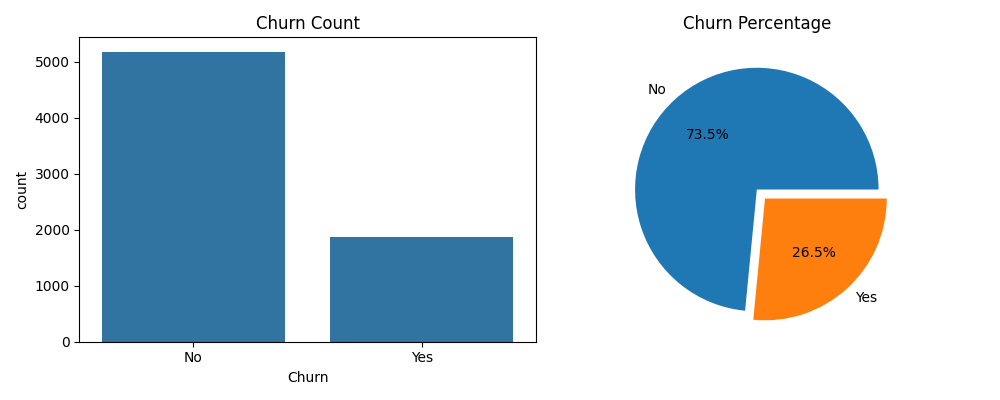
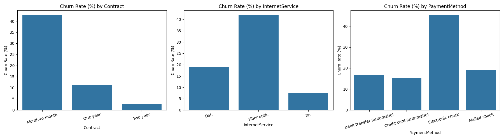
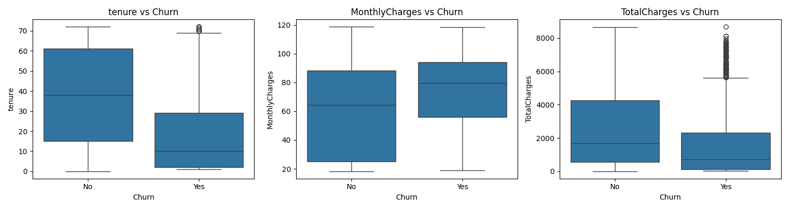
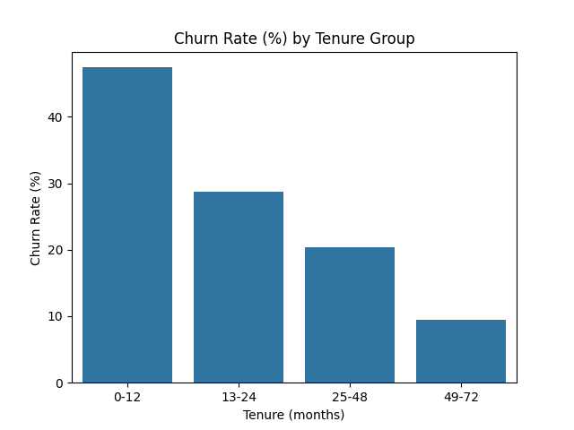
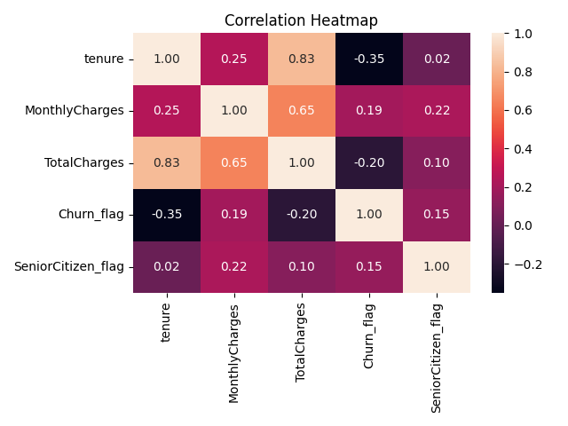

# Telco Customer Churn – Exploratory Data Analysis

## Project Overview
An Exploratory Data Analysis project using the IBM Telco Customer Churn dataset to understand customer behaviour and identify patterns associated with customer churn.

## Dataset
- 7,043 customer records
- 21 columns
- Target variable: Churn

## Technologies Used
- Python
- Pandas
- NumPy
- Matplotlib
- Seaborn
- Google Colab

## Project Steps
1. Data loading and inspection
2. Data cleaning and preprocessing
3. Missing-value analysis
4. Outlier detection using IQR
5. Univariate analysis
6. Bivariate analysis
7. Multivariate analysis
8. Business insights and recommendations

## Key Findings
- Overall churn rate: 26.5%
- Month-to-month contract churn: 42.7%
- One-year contract churn: 11.3%
- Two-year contract churn: 2.8%
- Fiber optic customer churn: 41.9%

## Project Notebook
Open `Telco_Customer_Churn_EDA.ipynb` to explore the complete analysis and visualisations.

## Author
Sandra V

Aspiring Data Scientist | Python | SQL | Data Analysis | Machine Learning

## Churn Distribution

This chart shows the distribution of customers who stayed and customers who churned.

**Key finding:** 26.5% of customers churned, while 73.5% stayed.

## Churn Rate by Contract, Internet Service and Payment Method

This chart compares customer churn rates across different contract types, internet services and payment methods.

**Key Findings:**
- Month-to-month contracts have the highest churn rate (42.71%).
- Fiber optic customers show a high churn rate (41.89%).
- Electronic check users have the highest churn rate (45.29%).

**Business Insight:**
The company should focus on retaining month-to-month customers, reviewing fiber optic service satisfaction and improving the electronic payment experience.

## Numerical Features vs Customer Churn

**Key Findings:**
- Customers who churned generally have shorter tenure.
- Customers who churned have higher monthly charges on average.
- Customers who stayed have higher total charges on average.

**Business Insight:**

The company should focus on improving early customer retention and reviewing pricing strategies to reduce churn.

## Churn Rate by Tenure Group

This chart analyses customer churn across four tenure groups.

**Key Finding:** Customers with 0–12 months of tenure have the highest churn rate (approximately 47.4%). Churn decreases as customer tenure increases.

**Business Insight:** The company should focus on onboarding, customer support, and retention offers during the first year to reduce early customer churn.

## Correlation Heatmap

The correlation heatmap illustrates the relationships between numerical features and customer churn.

### Key Findings
- Tenure and TotalCharges have a strong positive correlation (0.83).
- MonthlyCharges and TotalCharges have a positive correlation (0.65).
- Tenure and Churn have a negative correlation (-0.35).
- MonthlyCharges and Churn have a weak positive correlation (0.19).

### Business Insight
Customer tenure is an important factor to examine when understanding churn patterns. The company should focus on improving early customer retention and monitoring customers with shorter tenure.
