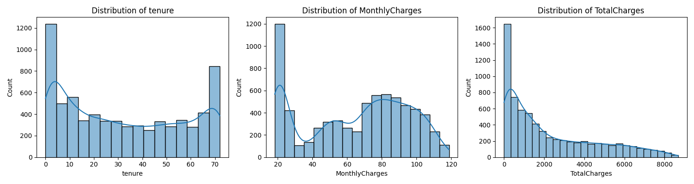
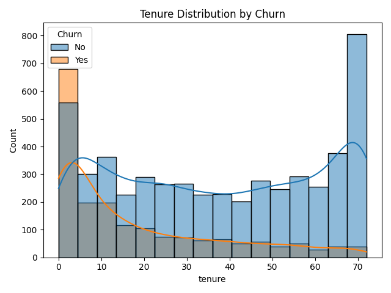
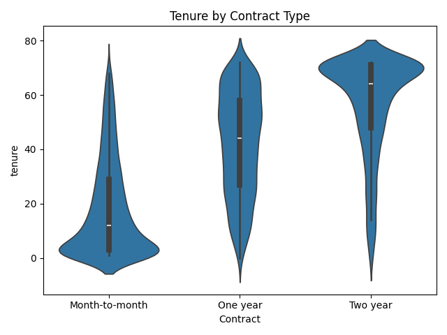
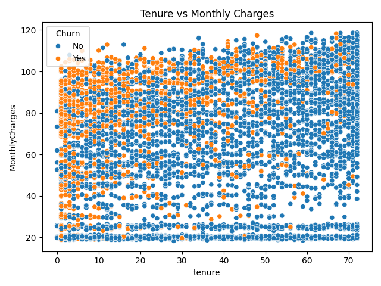
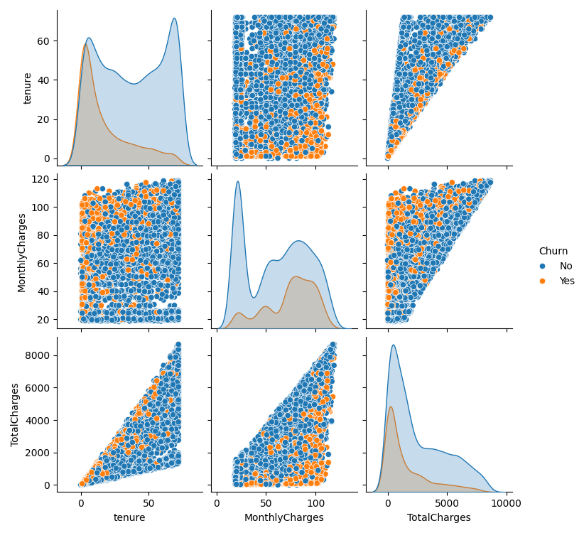

# Telco Customer Churn Analysis – Exploratory Data Analysis (EDA)

## Project Overview

This project performs Exploratory Data Analysis (EDA) on the IBM Telco Customer Churn dataset to understand customer behaviour and identify factors associated with customer churn.

The objective is to explore customer demographics, subscribed services, contract types, payment methods and billing information to discover patterns that can help a telecommunications company improve customer retention.

## Summary of Key Findings

- **26.5%** of customers churned (1,869 out of 7,043).
- **Contract type:** Month-to-month customers have the highest churn rate (42.71%), compared with 11.27% for one-year contracts and 2.83% for two-year contracts.
- **Customer tenure:** Customers in their first 12 months have the highest churn rate (about 47.4%), compared with about 9.5% for customers with more than 48 months of tenure.
- **Internet service:** Fiber optic customers have a churn rate of 41.89%, compared with 18.96% for DSL customers.
- **Payment method:** Electronic check users have the highest churn rate (45.29%), compared with about 15–17% for automatic payment methods.
- **Technical support:** Among customers with internet service, those without Tech Support have a higher churn rate (about 41.6%) than those who subscribe to it (about 15.2%).
- **Online security:** Among customers with internet service, those without Online Security also show a higher churn rate (about 41.8%) than those who subscribe (about 14.6%).

## Project Objectives

- Understand the distribution of customers who stayed and churned.
- Analyse numerical and categorical features.
- Identify customer groups with higher churn rates.
- Explore relationships between tenure, monthly charges and churn.
- Identify factors associated with higher churn rates.
- Generate meaningful business insights.

## Dataset Information

**Dataset:** IBM Telco Customer Churn

**Source:** [Kaggle – Telco Customer Churn Dataset](https://www.kaggle.com/datasets/blastchar/telco-customer-churn)

- Total records: 7,043 customers
- Total original columns: 21
- Target variable: `Churn`
- Dataset file: `WA_Fn-UseC_-Telco-Customer-Churn.csv`

The dataset contains customer demographics, subscribed services, contract details, payment methods and billing information.

## Technologies Used

- Python
- Jupyter Notebook
- Pandas
- NumPy
- Matplotlib
- Seaborn

## Project Workflow

1. Importing required libraries
2. Loading the dataset
3. Understanding the dataset
4. Data quality assessment
5. Data cleaning and preprocessing
6. Outlier detection using the IQR method
7. Univariate analysis
8. Bivariate analysis
9. Multivariate analysis and correlation
10. Business questions
11. Business insights and conclusion

## Data Cleaning Highlights

- Identified 11 blank values in `TotalCharges`. All 11 belong to customers with `tenure = 0`. For this analysis, these blank values were treated as 0, and the column was converted to float.
- No duplicate rows or duplicate customer IDs were found.
- `SeniorCitizen` was converted from 0/1 to No/Yes for categorical analysis.
- "No internet service" and "No phone service" were kept as separate categories, because these customers do not have the service at all, which is different from customers who have the service but chose "No".
- A numeric `Churn_flag` column was created (Yes = 1, No = 0) for churn-rate calculations and correlation analysis.
- A numeric `SeniorCitizen_flag` column was created so that `SeniorCitizen` could be included in the correlation heatmap.
- The IQR (1.5 × IQR) rule found no potential outliers in `tenure`, `MonthlyCharges` or `TotalCharges`, so no outlier treatment was applied.

---

# Exploratory Data Analysis and Visualizations

## 1. Customer Churn Distribution

This chart shows the distribution of customers who stayed and customers who churned.

**Key Findings:**
- 73.5% of customers stayed (5,174 customers).
- 26.5% of customers churned (1,869 customers).
- The data is imbalanced, with more customers staying than leaving.


## 2. Numerical Features Distribution

This section explores the distributions of tenure, MonthlyCharges and TotalCharges.

**Key Findings:**
- Tenure has two clear peaks: many new customers (0–5 months) and many long-term customers (about 70 months).
- MonthlyCharges has a large group at the low end (around 20) and another larger group between about 70 and 100.
- TotalCharges is right-skewed, with many customers having relatively low total charges.



## 3. Churn Rate by Customer Services

This comparison explores churn rates across contract types, internet services and payment methods. In the internet service chart, "No" means the customer has no internet service.

**Key Findings:**
- Month-to-month contracts have the highest churn rate (42.71%), compared with 11.27% (one year) and 2.83% (two year).
- Fiber optic customers have the highest churn rate among internet service groups (41.89%), compared with 18.96% for DSL and 7.40% for customers with no internet service.
- Electronic check users have the highest churn rate (45.29%), while automatic payment methods are about 15–17% and mailed check is about 19%.

**Business Insight:** The company should focus on retaining month-to-month customers, reviewing fiber optic service satisfaction and improving the payment experience.


## 4. Numerical Features vs Customer Churn

This analysis compares tenure, monthly charges and total charges between customers who stayed and customers who churned.

**Key Findings:**
- Customers who churned generally have shorter tenure (median 10 months compared with 38 months).
- Customers who churned have higher average monthly charges (approximately 74.44 compared with 61.27).
- Customers who stayed have higher total charges (average about 2,550 compared with 1,532), mainly because they stay longer.

**Note:** Each box plot calculates its whiskers separately for each group, so a few churned-customer points (mainly in tenure and TotalCharges) appear beyond the whiskers. This is different from the IQR check on the full columns, which found no potential outliers.


## 5. Tenure Distribution by Churn

This chart compares the tenure distributions of customers who stayed and customers who churned.

**Key Finding:** Customers who churned are more concentrated in the lower tenure range, and the number of churned customers falls steadily as tenure increases, suggesting that early customer retention is important.



## 6. Churn Rate by Tenure Group

Customers are divided into four tenure groups to compare their churn rates.

**Key Finding:** Churn falls steadily as tenure increases: about 47.4% for 0–12 months, 28.7% for 13–24 months, 20.4% for 25–48 months and 9.5% for 49–72 months.


## 7. Tenure by Contract Type

This violin plot compares customer tenure across month-to-month, one-year and two-year contracts.

**Key Finding:** Customers with longer-term contracts generally show longer tenure. The median tenure is 12 months for month-to-month, 44 months for one-year and 64 months for two-year contracts.



## 8. Tenure vs Monthly Charges

This scatter plot explores the relationship between customer tenure and monthly charges, with customers differentiated by churn status.

**Key Finding:** Churned customers appear more concentrated among customers with shorter tenure and higher monthly charges. Many points overlap, so this plot is best read together with the box plots in Section 4.



## 9. Numerical Features Pairplot

The pairplot visualises relationships between tenure, monthly charges and total charges, with customers grouped by churn status.

**Key Findings:**
- TotalCharges increases strongly with tenure.
- Churned customers are more concentrated at lower tenure and lower total charges.
- Churned customers show a peak at higher monthly charges (roughly 70–100).



## 10. Correlation Heatmap

The correlation heatmap displays relationships between numerical features, including the numeric `Churn_flag` and `SeniorCitizen_flag`.

**Key Findings:**
- Tenure and TotalCharges have a strong positive correlation (0.83).
- MonthlyCharges and TotalCharges have a positive correlation (0.65).
- Tenure and Churn_flag have a negative correlation (-0.35).
- MonthlyCharges and Churn_flag have a small positive correlation (0.19).
- SeniorCitizen_flag and Churn_flag have a small positive correlation (0.15).

**Note:** Correlation shows association, not causation.


---

## Key Business Insights

Based on the analysis:

- Focus on improving retention among month-to-month contract customers by offering benefits for moving to longer contracts.
- Give new customers extra attention during their first 12 months, when churn is highest.
- Investigate customer satisfaction and pricing for fiber optic services.
- Review the customer experience for electronic check users and encourage automatic payment methods.
- Promote Tech Support and Online Security bundles, and evaluate whether they help reduce churn.
- Monitor customers with higher monthly charges who may be at risk of leaving.

## Conclusion

The analysis highlights several patterns associated with customer churn, including contract type, tenure, internet service, payment method and billing patterns.

Customers with month-to-month contracts, shorter tenure, fiber optic services and electronic check payments show comparatively higher churn rates.

These findings can help the company develop targeted customer retention strategies and improve customer satisfaction.

## Limitations and Future Scope

This analysis identifies associations between customer characteristics and churn, not causes. The dataset does not contain detailed time information explaining when or why each customer left.

A possible next step is to build a machine learning model, such as Logistic Regression or Random Forest, to predict customer churn and evaluate model performance.

## Repository Structure

```text
telco-customer-churn-eda/
│
├── images/
│   ├── churn_distribution.png
│   ├── numerical_features_distribution.png
│   ├── churn_by_customer_services.png
│   ├── numerical_features_vs_churn.png
│   ├── tenure_distribution_by_churn.png
│   ├── churn_by_tenure_group.png
│   ├── tenure_by_contract.png
│   ├── tenure_vs_monthly_charges.png
│   ├── numerical_features_pairplot.png
│   └── correlation_heatmap.png
│
├── Telco_Customer_Churn_EDA.ipynb
├── requirements.txt
└── README.md
```

## How to Run the Project

### 1. Clone the repository

```bash
git clone https://github.com/sandravinod-web/telco-customer-churn-eda.git
```

### 2. Navigate to the project folder

```bash
cd telco-customer-churn-eda
```

### 3. Install the required libraries

```bash
pip install -r requirements.txt
```

### 4. Download the dataset

Download the IBM Telco Customer Churn dataset from [Kaggle](https://www.kaggle.com/datasets/blastchar/telco-customer-churn).

Save the file as `WA_Fn-UseC_-Telco-Customer-Churn.csv` in the same folder as the notebook.

### 5. Launch Jupyter Notebook

```bash
jupyter notebook
```

### 6. Open and run

Open `Telco_Customer_Churn_EDA.ipynb` and run all cells.

## Author

**Sandra V**

Data Science Learner | Python | SQL | Exploratory Data Analysis

GitHub: [sandravinod-web](https://github.com/sandravinod-web)
